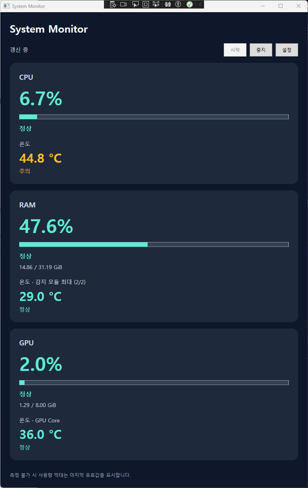
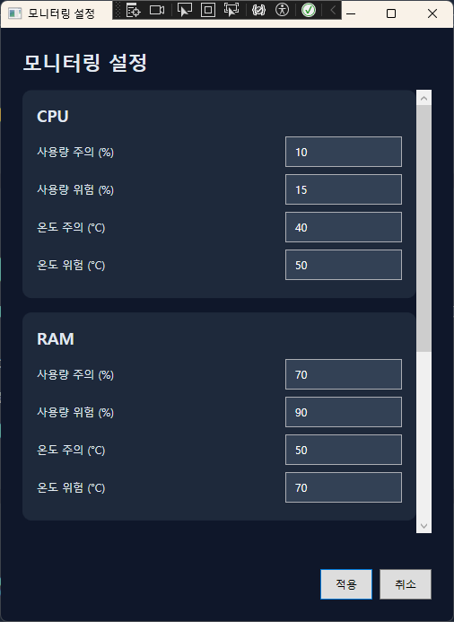

# SystemMonitor

C#과 WPF의 MVVM 패턴을 학습하며 만든 Windows용 PC 리소스 모니터링 앱입니다.
CPU·NVIDIA GPU·RAM의 사용량과 온도를 주기적으로 읽고, 사용자가 설정한 임계값에 따라 상태와 색상을 표시합니다.

## 실행 화면



실제 앱 실행 화면입니다. 표시되는 값과 온도 지원 여부는 하드웨어·드라이버·실행 권한에 따라 달라집니다. 창이 작으면 세로로 스크롤하여 다른 카드를 볼 수 있습니다.



## 주요 기능

- CPU·RAM·NVIDIA GPU 사용량 및 지원되는 온도 센서 표시
- RAM 사용 용량과 NVIDIA GPU 전용 메모리 사용 용량 표시
- 사용량·온도의 정상/주의/위험 상태와 색상 표시
- 장치별 주의·위험 임계값 설정
- 공통 갱신 간격 설정: 500~5000ms, 기본 1000ms
- 모니터링 시작·중지, 비동기 센서 수집 및 종료 시 작업 정리
- JSON 설정 저장·복원 및 저장 시 이전 파일 백업
- 센서 미지원·측정 실패 상태 구분

## 개발 환경과 실행 조건

| 항목 | 내용 |
|---|---|
| 운영체제 | Windows |
| 언어·UI | C#, WPF |
| 대상 프레임워크 | `net9.0-windows` |
| 빌드 | .NET 9 SDK 및 WPF 빌드 환경 |
| 프레임워크 종속 배포본 실행 | .NET 9 Windows Desktop Runtime |
| 하드웨어 라이브러리 | LibreHardwareMonitorLib 0.9.6 (NuGet) |

일부 CPU·RAM 센서는 관리자 권한과 PawnIO 등 라이브러리가 사용하는 드라이버 환경이 필요할 수 있습니다. 이 프로젝트는 드라이버를 자동 설치하거나 실행 권한을 자동 상승시키지 않습니다. 앱에서 센서가 표시되지 않는 경우 실행 권한·드라이버·하드웨어 지원 여부를 확인하세요.

## 빌드와 실행

저장소의 루트(`SystemMonitor.sln`이 있는 폴더)에서 실행합니다. 최초 복원에는 NuGet 패키지 다운로드를 위한 네트워크 연결이 필요합니다.

```powershell
dotnet restore SystemMonitor.sln
dotnet build SystemMonitor.sln -c Release
dotnet run --project SystemMonitor/SystemMonitor.csproj -c Release --no-build
```

Visual Studio에서는 .NET 9를 지원하는 버전과 **.NET 데스크톱 개발** 워크로드를 설치하고 `SystemMonitor.sln`을 열어 실행할 수 있습니다. 패키지 DLL을 수동 복사할 필요 없이 NuGet 복원으로 의존성을 가져옵니다.

### 게시

```powershell
dotnet publish SystemMonitor/SystemMonitor.csproj -c Release --self-contained false -o artifacts/publish
```

`artifacts/publish/SystemMonitor.exe`로 실행합니다. EXE 하나만 복사하지 말고 `runtimes` 폴더를 포함한 게시 폴더 전체를 함께 배포해야 합니다. 이 방식은 실행 PC에 .NET 9 Windows Desktop Runtime이 설치되어 있어야 합니다.

## 사용 방법

1. 앱 실행 후 **시작**을 눌러 센서 수집을 시작합니다.
2. **설정**에서 각 장치의 사용량·온도 임계값과 공통 갱신 간격을 입력합니다.
3. **적용**하면 파일에 저장한 뒤 현재 대시보드에도 반영합니다. **취소**하면 변경을 적용하지 않습니다.
4. **중지**를 누르면 수집을 멈춥니다. 카드에는 마지막 측정값이 남습니다.

사용량 임계값은 0~100 범위이며, 주의 값은 위험 값보다 작아야 합니다. 측정값이 주의·위험 임계값 이상이면 해당 상태가 됩니다.

| 색상 | 의미 |
|---|---|
| 초록 | 정상 |
| 노랑 | 주의 |
| 분홍 | 위험 |
| 회색 | 대기·미지원·측정 실패 등 판정 불가 |

측정 불가 시 사용량 막대는 마지막 유효값을 유지하므로, 상태 문구와 함께 확인하세요.

## 설정 파일

```text
%LOCALAPPDATA%\SystemMonitor\settings.json
```

- 파일이 없으면 기본 설정으로 시작합니다.
- 기존 설정을 교체할 때 이전 파일을 `settings.json.bak`에 보관합니다.
- 손상된 설정 등을 읽지 못하면 경고를 표시하고 기본값으로 시작합니다. 자동으로 백업을 복원하지는 않습니다.
- 실제 사용자 설정 파일은 소스 저장소에 포함하지 않습니다.

## 센서 선택과 현재 제한

| 항목 | 현재 구현 |
|---|---|
| CPU 사용량 | 첫 번째 CPU 장치의 `CPU Total` 센서 |
| CPU 온도 | `Core (Tctl/Tdie)` 센서. AMD 센서 이름을 기준으로 하며 모든 CPU를 지원하지는 않음 |
| RAM 사용량·용량 | 가상 메모리가 아닌 물리 메모리(`/ram`) 기준 |
| RAM 온도 | 감지된 DIMM 중 유효한 온도의 최댓값. 라벨에 유효 센서 수/감지 모듈 수 표시 |
| GPU | 첫 번째 NVIDIA 장치. AMD·Intel GPU 및 사용자 장치 선택은 미구현 |
| GPU 사용량·온도 | `GPU Core` 센서. 작업 관리자와 측정 기준이 다를 수 있음 |
| GPU 메모리 | `GPU Memory Used` / `GPU Memory Total`. 공유 메모리는 합산하지 않음 |

센서가 감지되지 않으면 `미지원`, 센서 읽기 또는 유효값 확인에 실패하면 `측정 실패`로 표시합니다. RAM 온도는 일부 모듈만 읽히면 그 유효한 모듈들 사이의 최댓값입니다.

이 앱은 학습 프로젝트이며 모든 하드웨어 조합에서 검증된 제품은 아닙니다. 장시간 기록, 그래프, 트레이 아이콘, 자동 실행 기능은 포함하지 않습니다.

## 프로젝트 구조

```text
SystemMonitor.sln
SystemMonitor/
  App.xaml / App.xaml.cs     앱 시작 및 의존성 연결
  Commands/                 RelayCommand, AsyncRelayCommand
  Models/                   측정 결과, 설정, 임계값, 상태
  Resources/                카드 DataTemplate과 상태별 스타일
  Services/                 센서 수집, 설정 파일 접근, 임계값 판정
  ViewModels/               화면 상태, 명령, 입력 검증
  Views/                    메인 창과 설정 창
docs/                       기획·검증·버전 기록과 화면 이미지
```

`MainViewModel`은 `IMonitoringService`를 생성자로 받아 사용합니다. 실제 센서 서비스 대신 `VirtualMonitoringService`를 연결해 가상 값으로 동작을 살펴볼 수 있습니다.

## 버전과 검증 기록

현재 소스의 앱 버전은 **1.0.0**입니다. 아직 Git 태그나 GitHub Release를 생성했다는 의미는 아닙니다.

- [변경 기록](CHANGELOG.md)
- [프로젝트 기획안](docs/project-plan.html)
- [전체 검증 기록](docs/verification-2026-10-29.md)
- [최종 수정·검증 기록](docs/v1.0.0.md)

## 외부 의존성

센서 수집에 [LibreHardwareMonitor](https://github.com/LibreHardwareMonitor/LibreHardwareMonitor)를 사용합니다. 패키지 버전은 프로젝트 파일에서 관리합니다. 코드 공개 또는 실행 파일 배포 시 해당 라이브러리와 전이 의존성의 라이선스·고지 조건을 확인해야 합니다. 이 저장소 자체의 라이선스는 아직 지정하지 않았습니다.
